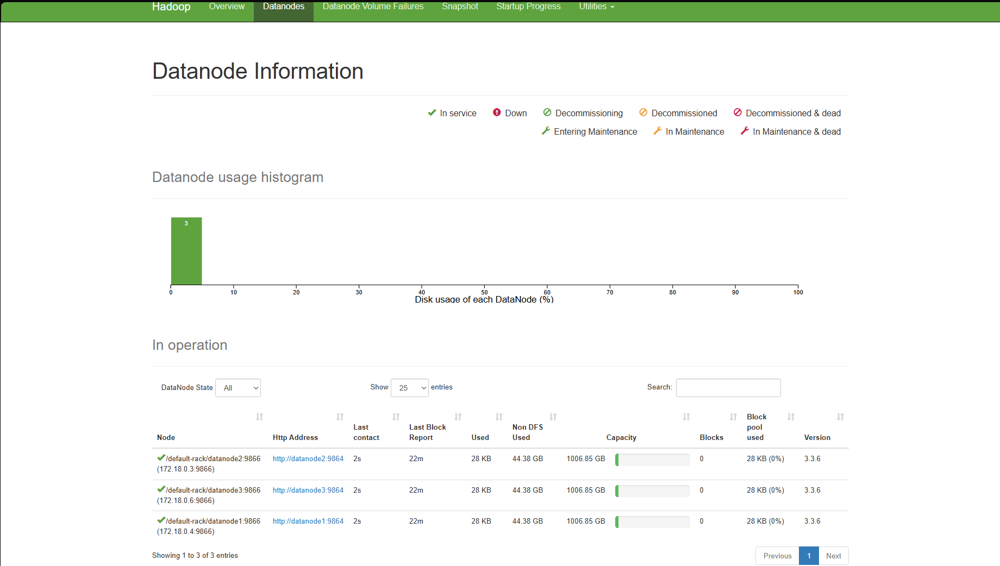
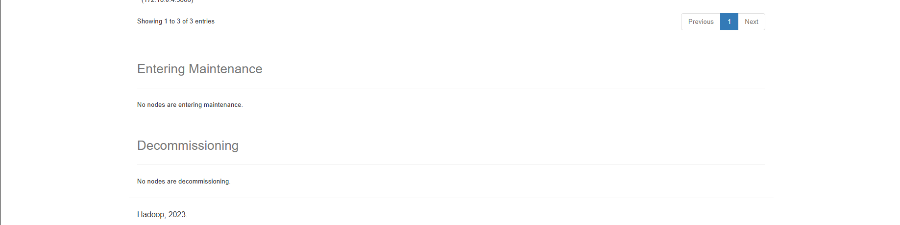
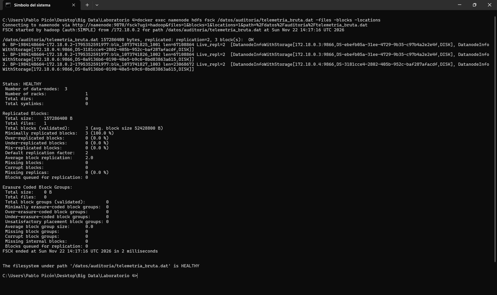
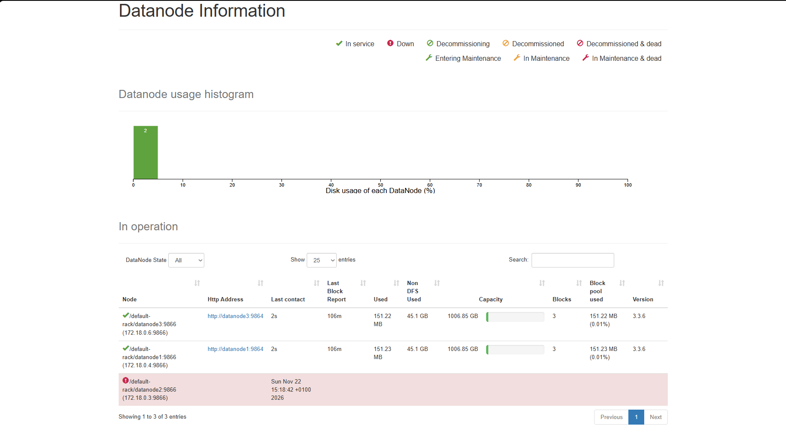
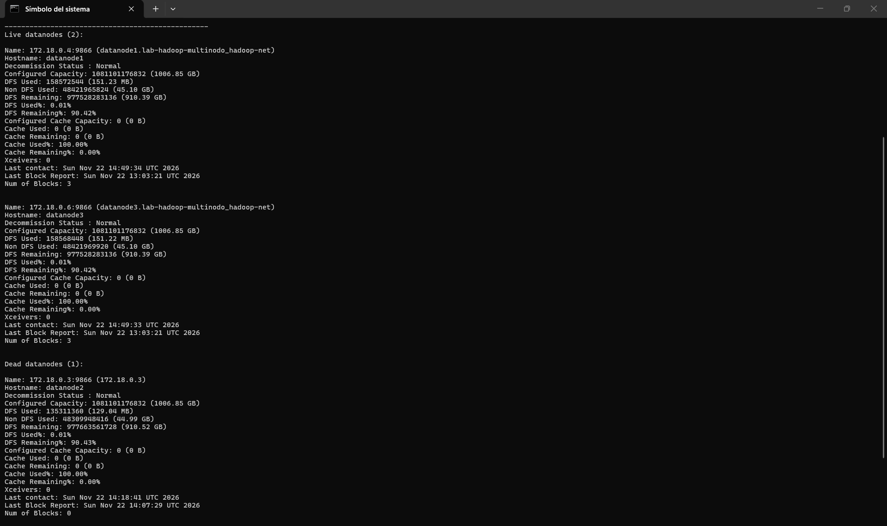
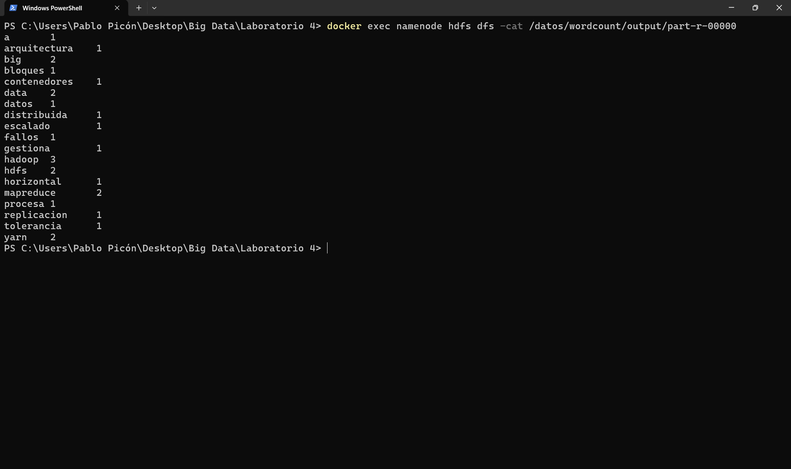
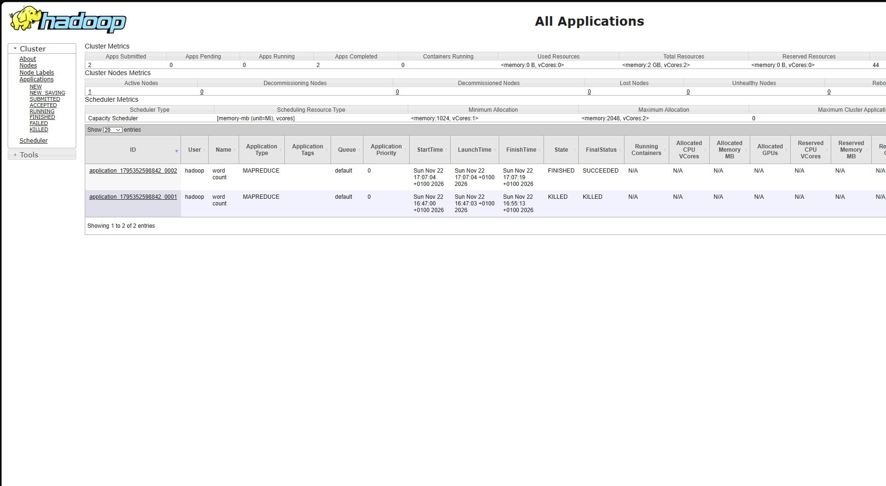
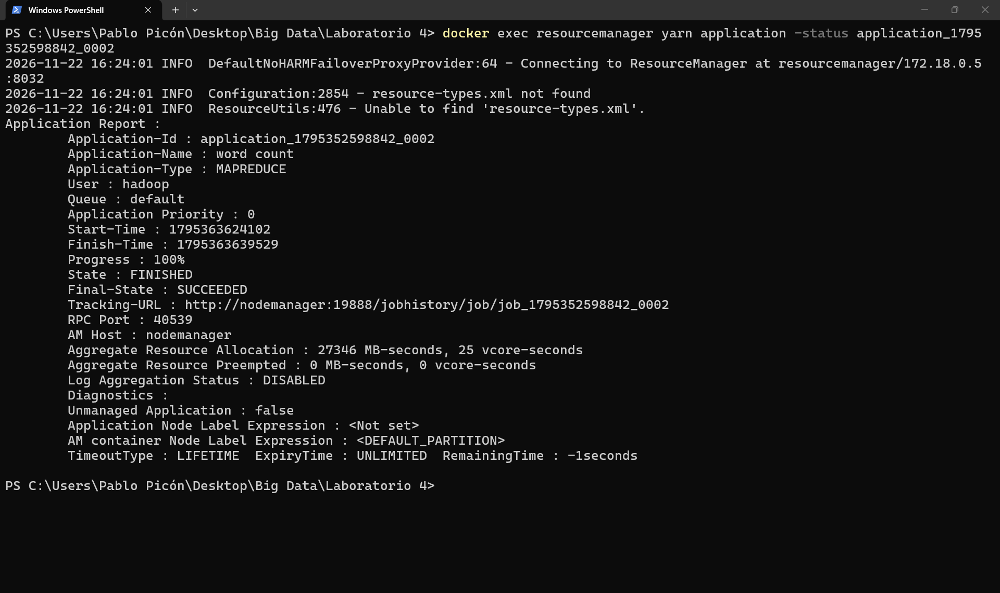

# Laboratorio Hadoop multi-nodo

Práctica del módulo de Big Data sobre despliegue de Apache Hadoop con Docker,
auditoría física de HDFS, tolerancia a fallos y ejecución MapReduce sobre YARN.

## Autoría y alcance

- **Alumno:** Manuel Pablo Picón Sánchez
- **Clúster:** Apache Hadoop 3.3.6, ejecutado con Docker Compose
- **Servicios:** NameNode, tres DataNodes, ResourceManager y NodeManager
- **Configuración HDFS:** bloques de 64 MiB y factor de replicación 2
- **Red Docker:** `hadoop-net`

## Evidencias

Las capturas muestran el estado del clúster, la comprobación de HDFS, la caída
controlada de un DataNode y la ejecución de WordCount. La captura web de YARN
corresponde a `http://localhost:8088/cluster/apps`.

### Estado del NameNode y DataNodes

La consola del NameNode muestra los tres DataNodes activos y sus datos de
almacenamiento.





Vista complementaria del panel de DataNodes, tomada antes de que los bloques de
la práctica aparecieran almacenados en ellos.

### Auditoría de bloques HDFS

La salida de `hdfs fsck` verifica los bloques, su ubicación y el estado
`HEALTHY` del fichero de auditoría.



### Tolerancia a fallos

La consola del NameNode muestra `datanode2` caído mientras los otros dos nodos
siguen activos.



La salida de `dfsadmin -report` confirma que HDFS detecta dos DataNodes vivos y
uno caído.



### Ejecución WordCount en YARN

La salida de `part-r-00000` muestra los recuentos de palabras generados por
WordCount.



La interfaz web de YARN muestra la aplicación WordCount con estado *FINISHED* y
resultado *SUCCEEDED*.



La consulta de estado por línea de comandos confirma el resultado exitoso de la
misma aplicación.



## Puesta en marcha

Desde PowerShell, en la raíz del repositorio:

```powershell
Set-Location .\docker
docker compose up -d
docker compose ps
```

Interfaces web:

- NameNode: <http://localhost:9870>
- YARN ResourceManager: <http://localhost:8088>
- Aplicaciones YARN: <http://localhost:8088/cluster/apps>

Comprobaciones HDFS:

```powershell
docker exec namenode hdfs dfsadmin -report
docker exec namenode hdfs fsck /datos -files -blocks -locations
```

El resultado de la auditoría final de `/datos` debe ser `HEALTHY`: cinco bloques
validados, dos réplicas por bloque y ningún bloque perdido, corrupto o
subreplicado.

## WordCount

El corpus de prueba se encuentra en
`/datos/wordcount/input/corpus_bigdata.txt`. El contenedor dispone de 2 GiB para
YARN; para que el ApplicationMaster y las tareas pudieran compartir ese límite,
el trabajo exitoso se lanzó con recursos ajustados solo para esa ejecución:

```powershell
docker exec namenode sh -c 'hadoop jar "$HADOOP_HOME"/share/hadoop/mapreduce/hadoop-mapreduce-examples-*.jar wordcount -D yarn.app.mapreduce.am.resource.mb=1024 -D mapreduce.map.memory.mb=512 -D mapreduce.reduce.memory.mb=512 -D mapreduce.map.java.opts=-Xmx256m -D mapreduce.reduce.java.opts=-Xmx256m /datos/wordcount/input /datos/wordcount/output'
```

Verificación del resultado:

```powershell
docker exec namenode hdfs dfs -ls /datos/wordcount/output
docker exec namenode hdfs dfs -cat /datos/wordcount/output/part-r-00000
docker exec resourcemanager yarn application -status application_1795352598842_0002
```

La aplicación `application_1795352598842_0002` finalizó con estado
`FINISHED` y resultado `SUCCEEDED`. La salida contiene 19 palabras distintas y
el marcador `_SUCCESS`.
